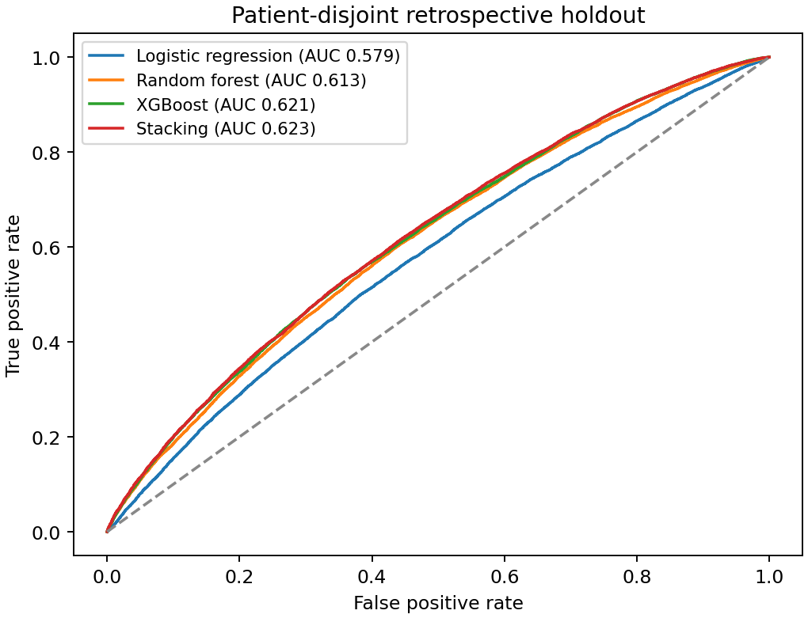

# Methods and interpretation

## Question

How well do demographics, laboratory measurements, and recorded vital signs classify ICU stays lasting at least two days?

## Data

The Python analysis uses 94,444 ICU stays from 65,355 patients. The outcome is `los_long`, which is true for stays lasting at least two days. [The BigQuery notebook](cohort-extraction.ipynb) joins ICU stays to admissions and patients and filters for adults using anchor age. The lab query matches by patient and selects the latest stored result before ICU entry for each lab item. The vital sign query selects the earliest storage time within a stay for each item and averages measurements tied at that time.

## Original coursework

The R and Python implementations each covered data preparation, preprocessing, logistic regression, random forest, boosting and model evaluation. The R implementation also included stacking and R Shiny. The available Python source covers BigQuery, XGBoost and Dash. The R history is based on my project account.

The [original Python modeling notebook](notebooks/course-modeling.ipynb) uses a 50/50 split stratified by the outcome. Its preprocessing pipelines use mean imputation for numeric values, most frequent imputation for categories and one-hot encoding with a reference category dropped. Randomized search uses ROC-AUC to tune elastic net logistic regression and random forest across three folds and XGBoost across five folds. The notebook evaluates fitted models on 47,222 test stays and records per-class precision, recall and F1. The aggregate results and plots below come from the saved notebook.

| Tuned model | Training accuracy | Test accuracy | Test ROC-AUC | Tuning plot |
| --- | ---: | ---: | ---: | --- |
| Logistic regression | 0.556 | 0.553 | 0.570 | [Penalty and mixing parameter](results/course-tuning-logistic.png) |
| Random forest | 0.959 | 0.587 | 0.624 | [Number of trees](results/course-tuning-random-forest.png) |
| XGBoost | 0.640 | 0.590 | 0.629 | [Learning rate and tree depth](results/course-tuning-xgboost.png) |

I built a [Dash application](app/README.md) that loaded the three original fitted pipelines. It supported model selection, manual or CSV prediction, and a labeled Parquet evaluation workflow with a ROC curve, classification report and confusion matrix.

## September 2026 portfolio evaluation

[train.py](train.py) uses a 50/50 split by patient with seed 203. The reconstructed original split shared 10,058 patients and the revised split shared zero. The November expansion preserves the final test set of 47,151 stays from 32,678 patients. It excludes marital status, which was already grouped using full-cohort frequencies in the exported cohort. Race grouping in the original extraction uses a fixed mapping. All four expanded models share the remaining predictors. The coursework and revision use different fits and test sets, so score changes cannot isolate the effect of patient overlap.

### Four-model expansion, November 2026

The models use fixed settings. Logistic regression uses L2 regularization with `C=1` and the LBFGS solver. Random forest uses 200 trees, depth 20 and a minimum leaf size of 2. XGBoost uses 300 trees, depth 3 and a learning rate of 0.05. Each fitted pipeline learns numeric imputation and scaling, categorical imputation and a one-hot encoder from its fitting data.

The stack uses five shuffled stratified folds grouped by patient (`StratifiedGroupKFold`, seed 203) within the 47,293 training stays. Each fold fits its own preprocessing and three base models on the fitting patients. The models produce one positive-class probability per validation stay. An L2 logistic regression (`C=1`, LBFGS) fits the three out-of-fold probabilities per stay. I then refit the base pipelines on all training patients and applied the fitted combiner to their three held-out probabilities. The audit records zero patient overlap in all five folds and exactly one out-of-fold prediction per model per training stay. No hyperparameter search or threshold selection used the test data.

All four models report ROC-AUC and, at a fixed probability threshold of 0.5, accuracy, precision, recall and F1 for stays lasting at least two days. See the [saved four-model scores](results/grouped-holdout-metrics.csv).

_ROC curves for the four-model expansion on the same patient-separated test cohort._

## Assumptions and interpretation

This is retrospective classification, not admission-time prediction. Vital signs are the earliest recorded anywhere in the ICU stay, while laboratory measurements have no bounded lookback and are joined by patient rather than admission. No external or temporal validation was performed.

## Result files

- [cohort-audit.json](results/cohort-audit.json)
- [grouped-holdout-metrics.csv](results/grouped-holdout-metrics.csv)
- [grouped-holdout-roc.png](results/grouped-holdout-roc.png)
- [course-python-metrics.csv](results/course-python-metrics.csv)
- [Original September two-model benchmark](results/september-2026-lr-rf/grouped-holdout-metrics.csv)

[MIMIC-IV v3.1 on PhysioNet](https://physionet.org/content/mimiciv/3.1/)

