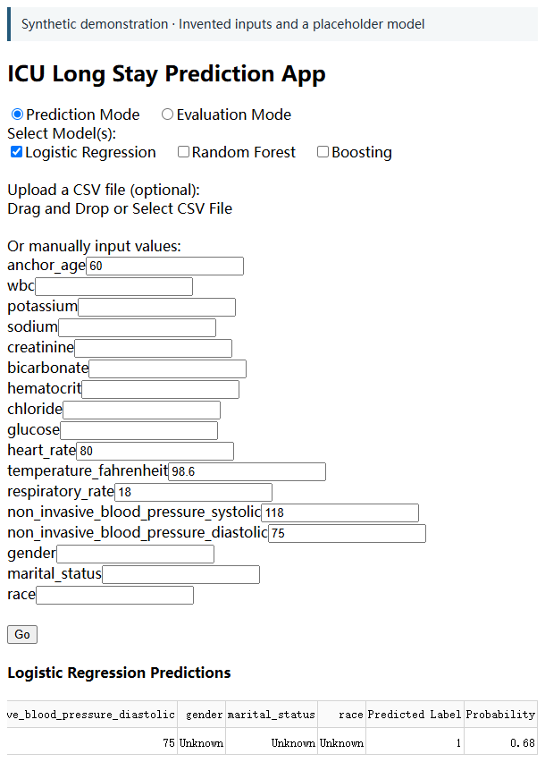

# Original Python Dash app

The [archived source](dash_course_app.py) is from the original Python coursework. The controls let you select logistic regression, random forest or XGBoost and switch between two modes.

- **Prediction.** Enter model features by hand or load a CSV of feature values. The app displays predicted classes and probabilities for each selected model.
- **Evaluation.** Load a Parquet file with the same features and a `los_long` label. The app displays accuracy, ROC-AUC, a ROC curve, a classification report and a confusion matrix.

[](dash-synthetic-preview.png)

The demonstration uses invented inputs and a placeholder model. The displayed probability is illustrative.

## Run locally

From the repository root, install the coursework environment:

```sh
python -m pip install -r requirements-course.txt
```

With credentialed access and an authorized local cohort, open [the original modeling notebook](../notebooks/course-modeling.ipynb) in Jupyter. Its training steps save `logit_model.pkl`, `rf_model.pkl` and `xgb_model.pkl` in the ignored local `models/` directory. Use only files generated locally with the same package environment. Pickle can execute code when loaded.

Once those files exist, start Dash from the repository root:

```sh
python app/dash_course_app.py
```

The server binds to `127.0.0.1`. Use synthetic inputs for demonstrations. Keep authorized inputs, exports and models local. The revised training script's model artifacts are separate from the coursework pickles.

The original Shiny source is unavailable. This directory contains the Python interface.
